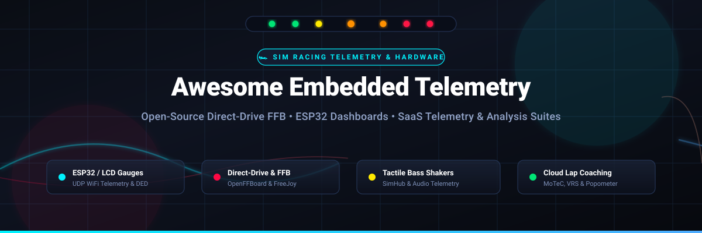

# Awesome-Embedded-Telemetry-Sim-Racing-Hardware


  





  
  
  
  
  



# 🏎️ Top Embedded Telemetry & Sim Racing Hardware

**Curated List of SaaS/Commercial Products & Open-Source GitHub Projects**  
*Focused on Real-Time Telemetry Dashboards, ESP32/Arduino Sim Rigs, Direct-Drive Force Feedback Firmware, Tactile Bass Shakers & Data Analysis Suites*  
**Last updated: November 2026**

This repository tracks notable **SaaS/Commercial platforms** and **open-source projects** for **Embedded Telemetry & Sim Racing Hardware**. These tools power UDP/shared-memory telemetry extraction, ESP32/Nextion/VOCORE hardware dashboards, open-source direct-drive wheelbases, load-cell pedal firmware, tactile bass-shaker vibration synthesis, and lap-by-lap suspension/tyre telemetry analysis for sim racers, motorsport engineers, and DIY hardware builders.

**Examples** include Fanatec FanaLab (Corsair), MoTeC i2 Pro, AiM Race Studio 3, SimCommander (SimXperience), SimHub, VRS Telemetry (Virtual Racing School), Popometer, Z1 Dashboard, Race Element, and Assetto Corsa Telemetry (the category leaders).

**🚀 Open-source emphasis**: This section is heavily expanded with every major active project for embedded ESP32/Arduino dashboards (`esp32-gt7-dashboard`, `SimHub` hardware sketches, `FreeJoy`), open-source direct-drive FFB firmware (`OpenFFBoard`, `FFBeast`), telemetry overlay/analysis tools (`Race Element`, `SecondMonitor`, `CrewChiefV4`, `pyirsdk`), and motion simulator controllers (`FlyPT Mover` / open motion rigs) — ideal for DIY sim-rig builders, embedded firmware developers, and motorsport data analysts.

🤝 Contributions welcome! Open a PR to add/update entries. Keep descriptions factual and link to official sites.

## 📑 Table of Contents
- [📊 Sector Overview & Market Dynamics](#-sector-overview--market-dynamics)
- [☁️ SaaS/Hosted & Commercial Platforms](#️-saashosted--commercial-platforms)
- [💻 Open-Source GitHub Projects](#-open-source-github-projects)
- [🛠️ How to Contribute](#️-how-to-contribute)
- [⚠️ Disclaimer](#️-disclaimer)
- [💖 Support & Thank You](#-support--thank-you)

## 📊 Sector Overview & Market Dynamics

The global Sim Racing Hardware and Motorsport Telemetry market is valued at approximately **$1.4B–$1.8B+ in 2026**, expanding at a ~12%–16% CAGR driven by direct-drive wheelbase democratization, FIA esports integration, and AI-assisted lap coaching. The hardware ecosystem is **moderately consolidated** around major peripheral manufacturers (Corsair/Fanatec, Logitech, Thrustmaster, Moza, Simucube), whereas the telemetry and embedded dashboard layer is **highly fragmented**—split between cloud lap-comparison SaaS platforms (VRS, Popometer), pro motorsport analysis suites (MoTeC, AiM), and a massive DIY ESP32/Arduino open-source maker community.

## ☁️ SaaS/Hosted & Commercial Platforms

*Sorted descending by company valuation / annual revenue scale.*

| Platform | Description | Company Scale (Valuation / Revenue) | Starting Paid Tier | Free Tier / Trial Limit |
| :--- | :--- | :--- | :--- | :--- |
| **[Fanatec FanaLab (Corsair)](https://fanatec.com)** | Official telemetry-driven tuning, rev-LED, OLED display, and dynamic force-feedback profile software for Fanatec wheelbases and pedals. | **Part of Corsair Gaming** (Acquired Fanatec/Endor AG; ~$1.3B+ Corsair annual revenue) | **$0 / Bundled with Fanatec Hardware** (Hardware ecosystem entry ~$399+) | **100% Free Software** (Full telemetry LED/OLED profiles and game-specific FFB tuning for Fanatec hardware owners) |
| **[MoTeC i2 Pro](https://motec.com.au)** | Industry-standard professional motorsport telemetry analysis software used by F1/GT teams and exported to by iRacing, ACC, and rFactor 2. | **~$50M–$100M Est. Scale** (Acquired by Bosch Motorsport; global racing electronics leader) | **$0 / Free Software Download** (Requires MoTeC hardware logger or sim telemetry exporter plugin) | **100% Free Forever** (Full i2 Standard & i2 Pro telemetry math channels, suspension histograms, and track maps free for sim analysis) |
| **[AiM Race Studio 3](https://aim-sportline.com)** | Professional motorsport data acquisition and dashboard configuration suite supporting real-world AiM loggers and Assetto Corsa / iRacing telemetry. | **~$50M–$80M Est. Revenue** (Leading Italian motorsport data-acquisition manufacturer) | **$0 / Free Software Download** (Compatible with AiM MXG/MXS dashes and sim telemetry bridges) | **100% Free Forever** (Complete telemetry analysis, GPS/track mapping, and custom dashboard layout designer at zero cost) |
| **[SimCommander (SimXperience)](https://simxperience.com)** | Commercial motion simulator, AccuForce direct-drive FFB, and tactile SimVibe chassis telemetry control suite. | **~$15M–$30M Est. Revenue** (Established US motion-sim and direct-drive hardware vendor) | **$89 one-time license** for SimCommander 4 (or bundled free with SimXperience hardware) | **No Perpetual Free Tier** (Hardware-bundled or paid standalone license; limited demo mode without license key) |
| **[SimHub (Commercial License)](https://simhubdash.com)** | Ubiquitous sim-racing telemetry hub driving Arduino/ESP32 displays, LED matrices, wind simulators, bass shakers, and motion rigs across 70+ games. | **~$5M–$15M Est. Scale** (Independent flagship sim-racing software platform) | **€6.00 – €10.00+ one-time donation** (Unlocks 60 FPS hardware dashboard refresh rate) | **Forever Free Unlicensed Version** (Full access to all 70+ game telemetry plugins, Arduino sketch generator, and bass shakers capped at **10 FPS** refresh) |
| **[VRS Telemetry (Virtual Racing School)](https://vrs.racing)** | Cloud-based sim racing telemetry analyzer, pro datapack comparison platform, and AI driving coach for iRacing, ACC, and F1. | **~$10M–$20M Est. Valuation** (~$3M–$6M est. ARR) | **$4.99 / month** (Dedicated 1-car datapack) or **$9.99 / month** (Competitive multi-car plan) | **Forever Free Rookie Tier** (Unlimited telemetry logging, basic lap comparison, and free Rookie series datapacks; 14-day trial on select plans) |
| **[Popometer](https://popometer.io)** | Web-based telemetry comparison, setup marketplace, and real-time voice/visual corner-by-corner coaching platform for ACC, iRacing, and LMU. | **~$5M–$10M Est. Valuation** (~$1M–$3M est. ARR; rapid growth in GT/endurance sim racing) | **€4.99 – €9.99 / month** for Telemetry Pro subscription (or per-setup datapack purchases) | **Forever Free Basic Account** (Upload and inspect personal laps, view basic track maps, and compare against personal bests; limited pro reference laps) |
| **[Z1 Dashboard](https://z1simwheel.com)** | Commercial multi-screen sim-racing digital dashboard, track map, radar, and telemetry analyzer suite supporting 30+ racing simulators. | **~$2M–$5M Est. Scale** (Boutique sim-racing telemetry software vendor) | **$24.99 – $39.99 / year** (or ~$59.99+ bundled Dashboard + Analyzer license) | **15-Minute Per-Session Free Demo** (Unlimited restarts with full dashboard and telemetry features capped at **15 minutes per run**) |
| **[Race Element](https://elementfuture.com)** | Telemetry-driven HUD overlay, pit-wall strategist, and embedded hardware LED controller built specifically for Assetto Corsa Competizione and iRacing. | **Community / Indie Sponsored Project** (Donation & Patreon supported) | **$0 / Free** (Optional Patreon/sponsor tiers for early beta features) | **100% Free Forever** (All HUD telemetry overlays, fuel calculators, and dual-sense/LED hardware integrations free) |
| **[Assetto Corsa Telemetry (ACTI / Native Shared Memory)](https://assettocorsa.it)** | Built-in shared-memory physics telemetry engine and MoTeC exporter ecosystem powering real-time wheel, tyre, and suspension data in Assetto Corsa & ACC. | **Part of Kunos Simulazioni / Digital Bros** (~$120M+ Digital Bros parent revenue) | **$0 / Included with Game** (Standard Kunos shared-memory API & ACTI bridge) | **100% Free Forever** (Full 333 Hz physics shared-memory telemetry access for external dashboards and data loggers) |

## 💻 Open-Source GitHub Projects

| Project | License / Hosting Cost | Free Tier / Self-Hosted Limit | Description |
| :--- | :--- | :--- | :--- |
| **[ESP32 GT7 Dashboard (`caa1211/esp32-gt7-dashboard`)](https://github.com)** | **Open-Source** ($0 firmware; runs on ~$10–$25 ESP32-S3 LCD boards) | **100% Free forever** (Unlimited wireless UDP telemetry decoding and real-time 60 FPS gauge rendering on ESP32 hardware) | Embedded ESP32 firmware decoding encrypted Gran Turismo 7 UDP telemetry packets over Wi-Fi to drive physical LCD steering-wheel dashboards. |
